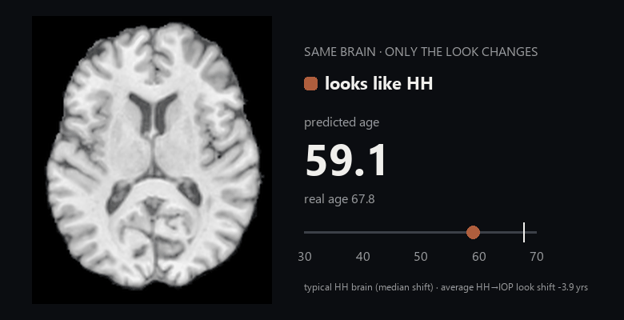
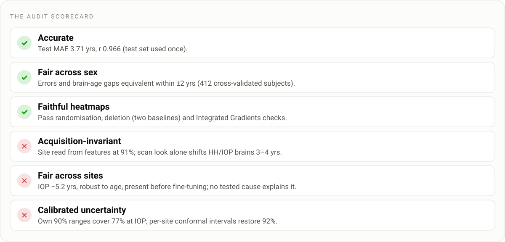
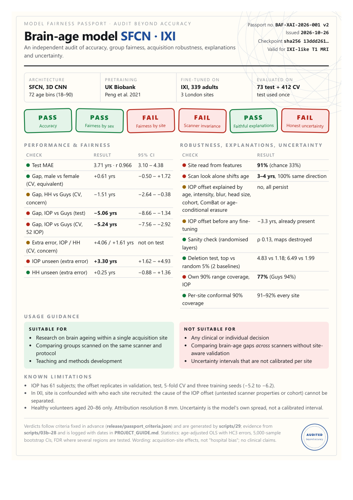
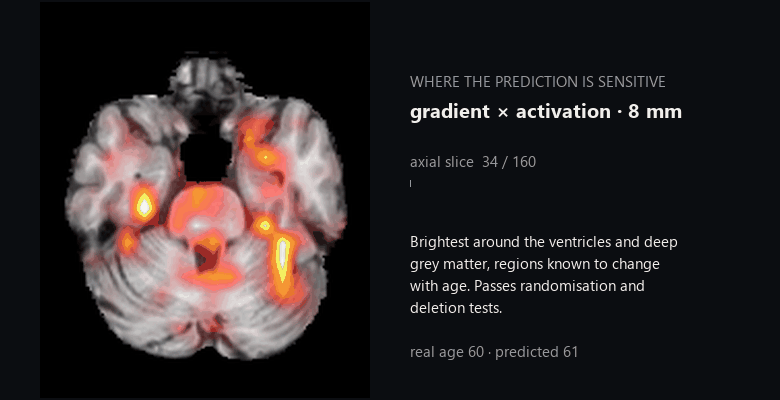
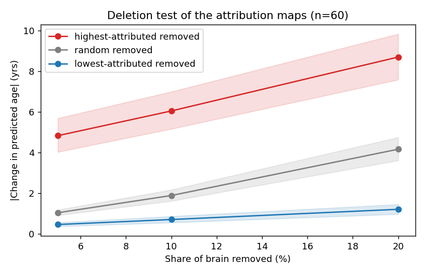
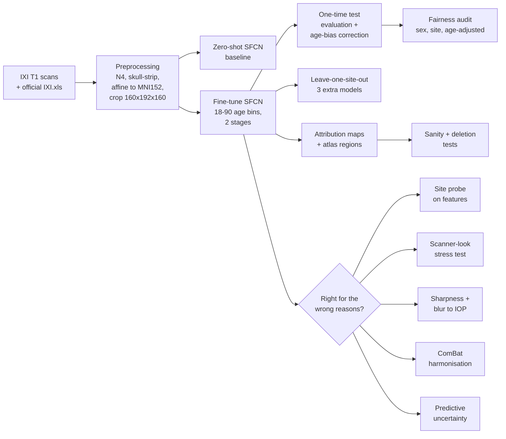

<div align="center">

<picture>
  <source media="(prefers-color-scheme: dark)" srcset="figures/readme/hero-dark.svg">
  
</picture>

**[Interactive website](demo/index.html)** · **[Live demo](demo/live_demo.py)** · **[Fairness passport](demo/passport.pdf)** · **[Report](report/report_draft.md)** · **[Project log](PROJECT_GUIDE.md)** · **[Reproduce it](#reproducing-the-results)**

<sub>Fine-tuned SFCN on 485 IXI brain MRIs · every number from code in this repo · test set used once · no clinical claims</sub>

</div>

---

## The 30-second version

A deep network reads a person's age from a brain MRI scan to within four years. We asked whether it is accurate **for everyone**, and whether it is accurate **for the right reasons**.

<div align="center">


<sub><b>The same brain, three scanner "looks".</b> The anatomy never changes, only the intensity profile, which is matched to each hospital's typical scan. The model's answer moves by about 4 years. This brain is a typical case, not a cherry-pick: it is the median HH brain, and across all 45 HH brains the IOP look made every one younger.</sub>
</div>

That is the heart of the project: **an accurate model whose answer depends partly on how the brain was scanned.**

<picture>
  <source media="(prefers-color-scheme: dark)" srcset="figures/readme/verdict-dark.svg">
  
</picture>

## The model's fairness passport

A one-page certificate for the audited model, like a nutrition label for AI. It gives a pass or fail stamp for each audit category, the evidence behind each one, what the model is and is not suitable for, and its known limits. It extends the idea of *model cards* (Mitchell et al. 2019) with checks that go beyond accuracy.

<div align="center">
<a href="demo/passport.pdf"></a>

<sub>Download: <a href="demo/passport.pdf">PDF (A4)</a> · <a href="demo/passport.html">HTML</a></sub>
</div>

## Contents

- [The story in seven findings](#the-story-in-seven-findings)
- [Method overview](#method-overview)
- [Results tables](#results-tables)
- [Caveats](#caveats)
- [Repository structure](#repository-structure)
- [Setup](#setup)
- [Reproducing the results](#reproducing-the-results)
- [An important correction](#an-important-correction)
- [Licences, attribution and references](#licences-attribution-and-references)

## Update: the robustness audit (Phase 10)

A reviewer-style re-examination added cross-validation, three training seeds and pre-specified, graded verdicts. The headline changed from "scanner bias" to **"a site disparity that is not explained by the scanner properties we can measure"**:

- **The IOP offset is real and robust.** 5-fold cross-validation over all 412 non-test subjects: **−5.24 years** [−7.62, −2.87], and −5.2 to −6.2 across three seeds. It survives eight ways of handling age (−3.9 to −5.2), including 1:1 age matching and a spline for age.
- **It exists before fine-tuning.** The UK Biobank model, which never saw IXI, already predicts IOP brains 3.3 years younger (p = 5×10⁻⁶). Fine-tuning only hides it for the IOP subjects it trains on.
- **Nothing we can measure explains it.** Intensity, blur, head size, education, BMI, ethnicity, ComBat, ComBat-GAM and age-conditional concept erasure all leave it in place. Plain concept erasure *appears* to remove it, but only because it also erases age.
- **Sex: equivalent** within ±2 years. **Heatmaps: faithful** under two deletion baselines and Integrated Gradients.
- **New fairness finding:** the model's 90% ranges cover only **77% of IOP subjects**; per-site conformal intervals restore 92%.

Scripts `17`–`29`, the paper in [`paper/`](paper/), and the pre-specified criteria and machine-readable passport in [`release/`](release/).

## The story in seven findings

A brain-age model predicts age from a T1-weighted MRI scan. The difference between predicted and real age, the *brain-age gap* (BAG), is studied as a marker of brain health. A model can be accurate overall and still be systematically off for one group, or reach its answers through features that have nothing to do with the brain.

**Setup.**

- **Data:** the public [IXI dataset](https://brain-development.org/ixi-dataset/), with 485 healthy adults aged 20–86 from three London hospitals (Guys, HH, IOP), split 339 / 73 / 73 into train / validation / test.
- **Main model:** SFCN (Peng et al. 2021), pretrained on UK Biobank and fine-tuned here.
- **Comparison model:** DeepBrainNet (Bashyam et al. 2020).

---

### ① It is accurate: fine-tuning halves the error

> **Test MAE 3.71 years [3.10, 4.38], r = 0.966.** The test set was evaluated once, after every decision had been made on train and validation data.

The UK Biobank model can only output ages 42–82, so every young adult comes out at about 55 (validation MAE 10.2). Re-training its head for ages 18–90 and fine-tuning the network brings validation MAE down to 3.9.

| Before: zero-shot (validation) | After: fine-tuned (test, evaluated once) |
|---|---|
|  |  |

### ② It is fair across sex, but one hospital stands apart

> **Men vs women: no difference.** The brain-age gap differs by −0.59 years [−2.67, +1.64]. **IOP vs Guys: −5.06 years [−8.66, −1.34]**, so IOP brains "look" five years younger.

<details>
<summary><b>How solid is the IOP offset?</b></summary>

- 8 of 9 IOP test subjects have a negative gap.
- Leaving out any single subject keeps the offset between −4.18 and −5.93.
- It replicates independently: validation −4.1, test −5.1.
- It is absent in the training subjects (−1.0), which the model fits closely. So it is a failure to generalise to **new** IOP people.
- Predictions were age-bias corrected (Cole et al. 2018) with a correction fitted on validation only. Every model controls for age, and intervals are 95% bootstrap CIs.

</details>


### ③ A model that never saw IOP stumbles there

> Leave-one-site-out: **IOP unseen costs +3.30 years of error** [+1.62, +4.93] (MAE 6.80 vs 3.59). HH unseen costs nothing.


### ④ The heatmaps show where it looks, and they pass every test

<div align="center">

</div>

Attribution concentrates on deep grey matter around the ventricles, which is known to change with age. The maps pass two checks:

- **Sanity check:** scrambling the model's layers destroys them (ρ = 0.13).
- **Deletion test:** smoothing away the top-ranked 5% of the brain moves the prediction by **4.8 years**. A random 5% moves it by 1.0 year, and the lowest-ranked 5% by 0.5. Top beats random in 93% of brains (p = 5×10⁻¹¹).

Attribution patterns differ **between sites**, and **not between sexes**.

<details>
<summary><b>Attribution figures</b></summary>

| Mean attribution, held-out subjects | Share of attribution by region and site |
|---|---|
|  |  |



</details>

### ⑤ It was only taught age, but it learned the scanner

> A simple classifier reads the **hospital** from the model's 64 internal features with **91%** balanced accuracy, after age and sex are removed. Chance is 33%, and age and sex alone get 41%.

The fingerprint is already in the pretrained model (93%) and in the raw input intensities (99.6%). Changing **only** a scan's intensity profile to another hospital's, with references standardised for age and sex, shifts predicted age by **3–4 years**:

- HH brains given IOP's look become younger: all 45 of 45.
- IOP brains given HH's look become older: all 18 of 18.


### ⑥ But IOP's five years are *not* a simple scanner artefact

We tested the three obvious acquisition explanations at IOP's measured levels. None reproduces the offset.

| Suspect | Test | Verdict |
|---|---|---|
| ❌ Brightness profile | Swap Guys ↔ IOP intensity profiles (age-standardised) | moves age by ≤ ~1 year |
| ❌ Blurrier images | IOP is ~2 SD smoother at identical resolution; blur Guys and HH brains to exactly IOP's level | +0.9 / 0.0 years, not younger |
| ❌ The feature fingerprint | ComBat removes it (site probe 91% → 36%, MAE 3.81 → 3.90) | offset −4.5 → −4.0, persists |

<details>
<summary><b>Why the age adjustment mattered, plus the figures</b></summary>

IOP recruited younger volunteers (mean 41 vs 48). Without standardising each hospital's "typical look" for age, IOP's look appeared to make brains younger (−0.60 years). After standardising, this effect almost vanished (+0.11). This careful check changed the conclusion.


</details>

What remains possible is either scanner properties not tested here, or genuine differences in IOP's volunteers. IXI cannot separate the two; travelling-subject data could.

### ⑦ It knows when it is unsure

> The model's own uncertainty is highest for IOP (+2.5 years, age- and sex-adjusted). It **doubles** when IOP was never seen (12.5 vs 6.1 years), while its 90% range still contains the true age **92%** of the time. It is less accurate there, but **not confidently wrong**.

For single brains, uncertainty only weakly predicts error (ρ = 0.16). It works as a warning signal for groups, not as an alarm for individual scans.


---

> [!IMPORTANT]
> **Reading across all seven:**
> - Sex shows no effect anywhere.
> - Acquisition site shows up in the brain-age gap, in generalisation, in attribution, in the representation and in uncertainty.
> - The prediction responds to scan appearance alone, so the model is **partly right for the wrong reasons**.
> - The IOP offset survives every acquisition explanation we tested.
>
> In IXI, site is confounded with who each hospital recruited. These are acquisition-site effects in a descriptive sense, not evidence about the people scanned. This is a methods audit on healthy volunteers and makes **no clinical claims**.

## Method overview



| Step | What is done | Script |
|---|---|---|
| Labels | Age, sex and site joined from the official `IXI.xls` on `IXI_ID`; subjects with no, missing or conflicting rows dropped | [`scripts/01b_official_labels.py`](scripts/01b_official_labels.py) |
| Preprocessing | N4 bias correction, ANTsPyNet skull-strip, brain-to-brain affine to MNI152NLin6Asym 1 mm, centre crop to 160×192×160, image QC | [`scripts/02b_preprocess_v2.py`](scripts/02b_preprocess_v2.py) |
| Zero-shot baseline | Unchanged UK Biobank SFCN on validation; linear correction fitted on train | [`scripts/03b_zero_shot.py`](scripts/03b_zero_shot.py) |
| Fine-tuning | New 72-bin head (ages 18–90, warm-started from the 42–82 bins), Gaussian soft labels, KL loss; head-only then full network with a lower backbone learning rate; early stopping on validation MAE | [`scripts/04_finetune_sfcn.py`](scripts/04_finetune_sfcn.py) |
| Test evaluation | Run once on the frozen checkpoint; age-bias correction fitted on validation; bootstrap CIs | [`scripts/05_evaluate_test.py`](scripts/05_evaluate_test.py) |
| Fairness audit | `BAG ~ sex + site + age` and `abs_error ~ sex + site + age`, HC3 standard errors, 5,000-resample bootstrap CIs | [`scripts/06_fairness_audit.py`](scripts/06_fairness_audit.py) |
| Leave-one-site-out | Retrain without each site (`--exclude-site`) and compare the unseen site against the seen sites' validation subjects | [`scripts/06b_loso_analysis.py`](scripts/06b_loso_analysis.py) |
| Attribution | \|Σ gradient × activation\| at `conv_2` (HiResCAM-style), Harvard-Oxford regions, `share ~ sex + site + age` with Benjamini-Hochberg FDR, randomisation sanity check | [`scripts/07_gradcam.py`](scripts/07_gradcam.py) |
| Site probe | Linear probe (CV on train) predicting site from the 64-d features, with and without age/sex regressed out | [`scripts/08_site_probe.py`](scripts/08_site_probe.py) |
| Stress test | Quantile-match each brain to each site's age/sex-standardised intensity profile; contrast, noise, blur, non-uniformity sweeps | [`scripts/09_acquisition_stress_test.py`](scripts/09_acquisition_stress_test.py) |
| Image sharpness | Native voxel size; gradient, Laplacian and FWHM sharpness by site, age/sex-adjusted | [`scripts/10_image_quality_by_site.py`](scripts/10_image_quality_by_site.py) |
| Blur to IOP | Per-subject Gaussian blur matched to IOP's smoothness | [`scripts/11_blur_to_iop.py`](scripts/11_blur_to_iop.py) |
| Harmonisation | ComBat on the features (train-fitted), age re-predicted through the unchanged head | [`scripts/12_harmonise_features.py`](scripts/12_harmonise_features.py) |
| Uncertainty | Predictive SD and 90%-range coverage, main and leave-one-site-out models | [`scripts/13_uncertainty.py`](scripts/13_uncertainty.py) |
| Deletion test | Smooth away the highest-, lowest- or randomly-ranked attribution cells | [`scripts/14_attribution_deletion_test.py`](scripts/14_attribution_deletion_test.py) |
| Website | Builds the self-contained interactive page from saved results | [`scripts/15_build_demo.py`](scripts/15_build_demo.py) |
| Live demo | Runs the model live in the browser: predict, explain + deletion test, scanner-look swap, site probe | [`demo/live_demo.py`](demo/live_demo.py) |

**Rules followed throughout** (from [`PROJECT_GUIDE.md`](PROJECT_GUIDE.md)):
- One model is trained on everyone, and results are split by group afterwards.
- Age is controlled for, and confidence intervals are reported.
- Nothing is tuned on the test set.
- The wording is "acquisition-site effects" (not "hospital bias") and "attribution patterns differ / are associated with" (not "the model thinks differently").

## Results tables

**Test set** (73 subjects, same split for every pipeline, each pipeline evaluated once; 95% bootstrap intervals):

| Pipeline | Model | Test MAE (years) | r | Documentation |
|---|---|---|---|---|
| Team pipeline (`scripts/`) | SFCN, fine-tuned, "v2" preprocessing | **3.71** [3.10, 4.38] | 0.966 | [`PROJECT_GUIDE.md`](PROJECT_GUIDE.md) (Phase 5) |
| `experiments/sfcn` | SFCN, fine-tuned (70 bins, `experiments/preprocessing` volumes) | 4.07 [3.43, 4.76] | 0.96 | [`experiments/sfcn/README.md`](experiments/sfcn/README.md) |
| `experiments/deepbrainnet` | DeepBrainNet, fine-tuned (blocks 4–5 + head) | 4.53 [3.86, 5.23] | 0.95 | [`experiments/deepbrainnet/README.md`](experiments/deepbrainnet/README.md) |
| Reference | DeepBrainNet zero-shot / + linear calibration | 6.32 / 6.29 | 0.89 | same |
| Reference | SFCN zero-shot / + linear calibration (`experiments/preprocessing` volumes) | 13.05 / 5.71 | 0.90 | [`experiments/sfcn/README.md`](experiments/sfcn/README.md) |

**Validation** (73 subjects). Comparisons between pipelines are only allowed here:

| Model | Validation MAE (years) |
|---|---|
| SFCN fine-tuned, team pipeline | 3.90 |
| SFCN fine-tuned, `experiments/sfcn` | 3.88 |
| DeepBrainNet fine-tuned | 4.12 |
| SFCN zero-shot, team pipeline (raw / train-fitted correction) | 10.21 / 6.85 |

The two fine-tuned SFCNs are equivalent on validation.

## Caveats

- **Test numbers do not rank pipelines.** The fine-tuned models were each selected on validation and evaluated once on the **same** test split, so any choice between pipelines has to be made on validation data. Within the two `experiments/` evaluations, the SFCN-versus-DeepBrainNet difference (+0.45 years, 95% CI [−0.38, +1.26]) is not distinguishable from zero.
- **Fairness and attribution analyses** apply to the team's SFCN pipeline. The `experiments/` models use the [`experiments/preprocessing/`](experiments/preprocessing/) volumes and have not had these analyses.
- **Small groups.** There is a single seed and a single split, so the intervals reflect only which 73 subjects were drawn. Subgroups are small (for example 9 IOP test subjects and 6 test subjects aged 40–49), so subgroup numbers are descriptive.
- **Sites.** All three IXI sites appear in the main model's training data. Generalisation to an unseen site is tested only by the leave-one-site-out analysis, and with three sites this says nothing about scanners outside IXI. Site is confounded with the population each site recruited.
- **Attribution method.** Standard Grad-CAM produced empty maps for 20–80% of subjects, depending on the target used. Gradient × activation was chosen for that reason alone, before any group comparison was run.
- **Zero-shot checks in `experiments/preprocessing`.** These used all 485 subjects (3 of 20 pilot subjects and 22 of 100 in an orientation test are test-split subjects). They involved no fitting and changed no decision, but they were not isolated from the test labels.
- **Old analyses are invalid.** Anything computed on the original, mis-labelled data is invalid (see [An important correction](#an-important-correction)), and the earlier sex-disparity outputs were removed ([`experiments/analysis/README.md`](experiments/analysis/README.md)).

## Repository structure

| Path | Purpose |
|---|---|
| [`README.md`](README.md), [`PROJECT_GUIDE.md`](PROJECT_GUIDE.md), [`implementation.md`](implementation.md) | Overview; living project guide (status of every phase with full results, data layout, analysis rules); original plan |
| [`scripts/`](scripts/) | **Team pipeline:** official labels, v2 preprocessing, zero-shot baseline, SFCN fine-tuning and test evaluation, fairness audit, leave-one-site-out, attribution |
| [`figures/`](figures/) | Key figures shown in this README |
| [`demo/`](demo/) | Interactive website (`index.html`, self-contained) and its template |
| [`report/`](report/) | Report draft |
| [`notebooks/`](notebooks/) | Phase 1–3 notebooks (data indexing, original preprocessing, zero-shot validation; Colab oriented) |
| [`experiments/preprocessing/`](experiments/preprocessing/README.md) | Alternative preprocessing, zero-shot inference, accuracy reports, input verification, label rebuild. `legacy/` holds the original, superseded preprocessing script |
| [`experiments/sfcn/`](experiments/sfcn/README.md) | SFCN fine-tuning experiment: training and evaluation code, reports |
| [`experiments/deepbrainnet/`](experiments/deepbrainnet/README.md) | DeepBrainNet fine-tuning experiment (PyTorch port of the Keras model): code, reports |
| [`experiments/data_splits/`](experiments/data_splits/README.md) | Train/validation/test assignment (IDs only) and the list of excluded scans |
| [`experiments/analysis/`](experiments/analysis/README.md) | Sex-disparity analysis script for the `experiments/` models (no valid results published yet) |
| `external/` | **Not tracked.** Local clones of the two pretrained-model repositories (below) |

## Setup

The `experiments/` code was tested with:

- Python 3.11, `torch 2.6.0+cu124`, `tensorflow 2.20.0`, `tf_keras 2.20.1`
- `antspyx 0.6.3`, `antspynet 0.3.2`, `nibabel 5.4.2`, `nilearn 0.14.1`
- `numpy 2.3.5`, `pandas 3.0.6`, `scipy 1.15.3`, `statsmodels 0.15.0`, `scikit-learn 1.9.1`, `matplotlib 3.11.2`, `xlrd 2.0.2`, `pillow 12.3.0`

The team pipeline (`scripts/`) also runs on Python 3.10 with `torch 2.x` (CPU or CUDA) and needs `templateflow` for the template and atlases. DeepBrainNet is a legacy Keras-2 model, so it is loaded through `tf_keras`. Fine-tuning ran on a 6 GB laptop GPU or a Colab T4. Preprocessing and the analyses also run on a laptop CPU; attribution for all 485 subjects takes about 15 minutes.

### Pretrained-model repositories (clone into `external/`)

| Directory | Source | Pinned commit | Licence | Weights (verify with SHA256) |
|---|---|---|---|---|
| `external/UKBiobank_deep_pretrain` | <https://github.com/ha-ha-ha-han/UKBiobank_deep_pretrain> | `4e56dc1522ac89caadc5c6fc779799ee58c23adc` | MIT | `brain_age/run_20190719_00_epoch_best_mae.p`, 11,827,312 bytes, `f9197c92486a8dba7fd87bb9f2ecc4f42f7c9628b9150d1b95c8a5ac10721ad3` (stored in the repo) |
| `external/DeepBrainNet` | <https://github.com/vishnubashyam/DeepBrainNet> | `505f4e4fdda6a2f5773bec0c98ef567a7a4ae36e` | no licence file in the repository | `Models/DBN_model.h5` (Git LFS), 182,983,936 bytes, `9257e98e9aff88bfcd83acdb1e74ffde762967503ef6df16c9270aa39d9941ea` |

Run these from the repository root in a POSIX shell (Git Bash, WSL, macOS/Linux). If `external/` already exists, do not re-run the clone commands over it. On Windows PowerShell, use these instead of `mkdir -p` and `sha256sum`:

- `New-Item -ItemType Directory external`
- `Get-FileHash DeepBrainNet\Models\DBN_model.h5 -Algorithm SHA256`

```bash
mkdir -p external && cd external
git clone https://github.com/ha-ha-ha-han/UKBiobank_deep_pretrain.git
git -C UKBiobank_deep_pretrain checkout 4e56dc1522ac89caadc5c6fc779799ee58c23adc
git lfs install
git clone https://github.com/vishnubashyam/DeepBrainNet.git
git -C DeepBrainNet checkout 505f4e4fdda6a2f5773bec0c98ef567a7a4ae36e
git -C DeepBrainNet lfs pull                       # if this is blocked, download Models/DBN_model.h5 in a browser
sha256sum DeepBrainNet/Models/DBN_model.h5          # must match the table
```

Weight checks:

- `experiments/preprocessing/infer.py` refuses to run DeepBrainNet if the weights' size or SHA256 differ.
- SFCN is loaded with `strict=True` everywhere.
- antspynet's `brainAgeDeepBrainNet` weights are a byte-identical copy of `DBN_model.h5`.
- Pretrained weights are never committed or modified; fine-tuned checkpoints are written to separate files.

### Data (not redistributed)

- **IXI data:** the T1 scans and the demographics spreadsheet `IXI.xls` (CC BY-SA 3.0; cite the source) from <https://brain-development.org/ixi-dataset/>.
- **Templates and atlases:**
  - Team pipeline: TemplateFlow `MNI152NLin6Asym`, plus the Harvard-Oxford atlases for attribution, downloaded automatically.
  - Experiments: see [`experiments/preprocessing/assets/README.md`](experiments/preprocessing/assets/README.md).
- **Paths:**
  - Team scripts take `--project-dir` (the folder holding the labels, volumes and `results/`).
  - The experiments read `PROJECT_DIR` at the top of `experiments/preprocessing/common.py`; edit it for your machine.
  - Large outputs are written under that folder, not into Git.

## Reproducing the results

### Team pipeline (`scripts/`)

```bash
P=/path/to/project_dir          # holds IXI_data/, the split CSVs and results/
# 1. labels from the official IXI.xls
python scripts/01b_official_labels.py --project-dir $P
# 2. preprocessing (resumable; try --smoke first)
python scripts/02b_preprocess_v2.py --project-dir $P
# 3. zero-shot baseline on validation
python scripts/03b_zero_shot.py --project-dir $P --sfcn-repo external/UKBiobank_deep_pretrain
# 4. fine-tuning (try --smoke first; GPU recommended)
python scripts/04_finetune_sfcn.py --project-dir $P --sfcn-repo external/UKBiobank_deep_pretrain
# 5. one-time test evaluation (refuses to overwrite existing results)
python scripts/05_evaluate_test.py --project-dir $P --checkpoint $P/checkpoints/sfcn_finetune_official/best.pt
# 6. fairness audit, then leave-one-site-out (one training run per site)
python scripts/06_fairness_audit.py --project-dir $P
for S in IOP HH Guys; do python scripts/04_finetune_sfcn.py --project-dir $P --exclude-site $S; done
python scripts/06b_loso_analysis.py --project-dir $P --out-dir $P/results/phase6b
# 7. attribution maps and atlas comparison
python scripts/07_gradcam.py --project-dir $P --checkpoint $P/checkpoints/sfcn_finetune_official/best.pt
# 8. right for the wrong reasons? (run in this order: 09-14 reuse earlier outputs)
CK=$P/checkpoints/sfcn_finetune_official/best.pt
python scripts/08_site_probe.py --project-dir $P --checkpoint $CK
python scripts/09_acquisition_stress_test.py --project-dir $P --checkpoint $CK
python scripts/10_image_quality_by_site.py --project-dir $P
python scripts/11_blur_to_iop.py --project-dir $P --checkpoint $CK
python scripts/12_harmonise_features.py --project-dir $P --checkpoint $CK
python scripts/13_uncertainty.py --project-dir $P --checkpoint-root $P/checkpoints
python scripts/14_attribution_deletion_test.py --project-dir $P --checkpoint $CK
# 9. website
python scripts/15_build_demo.py --project-dir $P
# live demo in the browser (needs gradio; opens http://127.0.0.1:7860)
python demo/live_demo.py --project-dir $P --sfcn-repo external/UKBiobank_deep_pretrain --checkpoint $P/checkpoints/sfcn_finetune_official/best.pt
```

Each script's docstring lists its options and outputs. [`PROJECT_GUIDE.md`](PROJECT_GUIDE.md) records the exact numbers each step produced.

### Experiments (`experiments/`)

```bash
# 1. labels: build the scan index with the Phase 1 notebook, then rebuild labels from the genuine IXI.xls
python experiments/preprocessing/label_fix/build_labels.py --xls <path/to/IXI.xls> --out <PROJECT_DIR>
# 2. preprocessing (resumable) and zero-shot inference
python experiments/preprocessing/preprocess.py --pilot            # small check first
python experiments/preprocessing/preprocess.py --all --retry-failed --workers 3
python experiments/preprocessing/infer.py --model dbn  --subset all
python experiments/preprocessing/infer.py --model sfcn --subset all
python experiments/preprocessing/accuracy_report.py --pred <dbn_predictions_all.csv> --tag all_inclusive
python experiments/preprocessing/verify_inputs.py                 # orientation / tensor / split checks
python experiments/preprocessing/to_npy.py                        # optional .npy copies
# 3. fine-tuning experiments: see experiments/sfcn/README.md and experiments/deepbrainnet/README.md
```

The two fine-tuning experiments document their own commands. `experiments/preprocessing/run_rest_after_preprocess.sh` is an optional wrapper that chains preprocessing, DeepBrainNet inference and the reports. It contains hard-coded `G:` paths and must be adapted.

### What is not in Git

These are generated or third-party and are listed in `.gitignore`:

- logs
- per-subject prediction and label tables
- MRI volumes, `.npy` arrays and attribution maps
- model checkpoints and pretrained weights
- registration templates
- the local `external/` clones

Some reports refer to these files by name; the scripts above produce them.

## An important correction

An early version of this project attached age and sex to the wrong subjects: a row-index column had been used as the IXI ID. This made correct models look broken. The error was found independently in two ways:

- by checking each subject against the official `IXI.xls`;
- by comparing with the public iAudit repository, whose per-subject ages agree with the corrected labels.

Labels are now rebuilt from the genuine `IXI.xls`, joined on `IXI_ID`:

- [`scripts/01b_official_labels.py`](scripts/01b_official_labels.py)
- [`experiments/preprocessing/label_fix/build_labels.py`](experiments/preprocessing/label_fix/build_labels.py)

Both give the same 485-subject split and the same 14 exclusions.

## Licences, attribution and references

- **IXI data:** CC BY-SA 3.0 (cite the IXI project).
- **SFCN code and weights:** MIT (Han Peng).
- **DeepBrainNet:** no licence file, so the repository is not redistributed here. The only DeepBrainNet material included is a figure showing one of its sample slices (`experiments/preprocessing/reports/input_verification.png`).
- **iAudit** (<https://github.com/sudarsan2507-hue/iAudit>), used for comparison: MIT licensed.
- **Templates and atlases:**
  - The registration templates (TemplateFlow MNI152, ICBM152) are under the permissive MNI/McGill licence; keep the copyright notice (see `experiments/preprocessing/assets/README.md`).
  - The Harvard-Oxford atlases are distributed with FSL via TemplateFlow.
- **This repository** does not yet declare its own licence.

References:

- Peng H. et al. (2021). Accurate brain age prediction with lightweight deep neural networks. *Medical Image Analysis* 68:101871.
- Bashyam V. M. et al. (2020). MRI signatures of brain age and disease over the lifespan based on a deep brain network and 14,468 individuals worldwide. *Brain* 143(7):2312–2324.
- Cole J. H. et al. (2018). Brain age predicts mortality. *Molecular Psychiatry* 23:1385–1392. (age-bias correction)
- Adebayo J. et al. (2018). Sanity checks for saliency maps. *NeurIPS*.
- Fortin J.-P. et al. (2018). Harmonization of cortical thickness measurements across scanners and sites. *NeuroImage* 167:104–120.
- Johnson W. E., Li C. & Rabinovic A. (2007). Adjusting batch effects in microarray expression data using empirical Bayes methods. *Biostatistics* 8(1):118–127.
- Samek W. et al. (2017). Evaluating the visualization of what a deep neural network has learned. *IEEE TNNLS* 28(11):2660–2673.
- Draelos R. L. & Carin L. (2020). Use HiResCAM instead of Grad-CAM for faithful explanations of convolutional neural networks. arXiv:2011.08891.
- Selvaraju R. R. et al. (2017). Grad-CAM: visual explanations from deep networks via gradient-based localization. *ICCV*.

## Contributors

[@Jaaiwanth](https://github.com/Jaaiwanth) and [@Adharshan98](https://github.com/Adharshan98).
