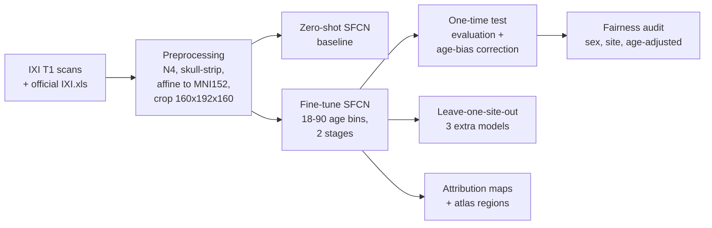

# Right for the Wrong Reasons? Auditing Brain-Age Model Fairness Beyond Accuracy

**A brain-age model fine-tuned on public MRI data: how accurate it is, whether it is equally accurate across sex and acquisition site, and where in the brain its attributions fall.**

A brain-age model predicts a person's age from a T1-weighted MRI scan. The difference between predicted and real age is called the *brain-age gap* (BAG) and is studied as a candidate biomarker. A model can be accurate overall and still be systematically off for one group, or reach its predictions through different image features for different groups. This project audits that "beyond accuracy" question on the public [IXI dataset](https://brain-development.org/ixi-dataset/): healthy adults aged 20–86, scanned at three London hospitals.

| | |
|---|---|
| **Data** | IXI T1 MRI, 485 subjects with official labels; 339 / 73 / 73 train / validation / test; sites Guys, HH, IOP |
| **Main model** | SFCN (Peng et al. 2021), pretrained on UK Biobank, fine-tuned on IXI |
| **Comparison model** | DeepBrainNet (Bashyam et al. 2020), fine-tuned |
| **Test accuracy** | MAE **3.71 years** [3.10, 4.38], r **0.966** |
| **Sex** | no detectable difference in brain-age gap, error or attribution |
| **Acquisition site** | IOP brain-age gap about **5 years lower** than Guys; IOP accuracy drops about **3 years** when unseen in training; attribution patterns differ between sites |
| **Right for the wrong reasons?** | Partly. The site can be read from the model's features (**91%**, chance 33%), and changing only a scan's intensity appearance moves predicted age by **3–4 years**. Yet the IOP offset is **not** explained by intensity, blur or the feature fingerprint. The model's uncertainty rises at IOP. |

> This is a methods and fairness audit on healthy volunteers. It makes **no clinical claims**.

**Interactive website:** open [`demo/index.html`](demo/index.html) in a browser (it works offline). It walks through the findings chapter by chapter and lets you explore individual brains. **Report draft:** [`report/report_draft.md`](report/report_draft.md).

## Contents

- [Research questions](#research-questions)
- [Key findings](#key-findings)
- [Method overview](#method-overview)
- [Results tables](#results-tables)
- [Caveats](#caveats)
- [Repository structure](#repository-structure)
- [Setup](#setup)
- [Reproducing the results](#reproducing-the-results)
- [An important correction](#an-important-correction)
- [Licences, attribution and references](#licences-attribution-and-references)

## Research questions

1. **Accuracy:** how well do pretrained brain-age CNNs predict age on IXI, and what does fine-tuning add over zero-shot use?
2. **Fairness:** do prediction error or the brain-age gap differ by **sex** or **acquisition site** once age is controlled for? Does the model generalise to a site it never saw?
3. **Attribution:** where in the brain do the model's attributions fall, and do those patterns differ between groups?
4. **Right for the wrong reasons?** Does the model's representation encode the acquisition site? Does its prediction respond to acquisition appearance when the anatomy is unchanged? Can intensity, blur or the feature-level site signature explain the IOP offset? Does the model know when it is unsure?

## Key findings

### 1. Fine-tuning roughly halves the error

The pretrained SFCN is already strongly age-related zero-shot (validation r 0.91). However, its UK Biobank output head only covers ages 42–82, so younger IXI subjects are predicted far too old. Fine-tuning with a wider 18–90 head brings validation MAE from 10.2 years (6.9 with a linear correction) to 3.9. The single test evaluation gives MAE 3.71.

| Zero-shot SFCN (validation) | Fine-tuned SFCN (test, evaluated once) |
|---|---|
|  |  |

### 2. No sex difference; an acquisition-site effect at IOP

The test predictions were age-bias corrected (Cole et al. 2018), with the correction fitted on validation only. Models then control for age; the intervals are 95% bootstrap CIs.

- **Sex:** male vs female BAG −0.59 years [−2.67, +1.64]; absolute error −0.64 [−1.90, +0.59].
- **IOP vs Guys:** BAG **−5.06 years [−8.66, −1.34]**. 8 of 9 IOP test subjects have a negative gap, and leaving out any one subject keeps the effect between −4.18 and −5.93.
- **Accuracy:** no group difference in absolute error has a CI that excludes 0.


### 3. IOP is the site a model cannot generalise to unseen

Three extra models were each trained without one site and evaluated on that site's subjects (leave-one-site-out):

- HH generalises.
- A model that never saw IOP is **3.30 years less accurate** there [+1.62, +4.93]: MAE 6.80 vs 3.59.
- The IOP-vs-Guys gap has the same sign in every analysis.


### 4. Attribution patterns differ between sites, not between sexes

Attribution maps (gradient × activation at SFCN's `conv_2`) were summarised with the Harvard-Oxford atlas on 146 held-out subjects. Across all groups, most attribution falls on deep grey matter around the lateral ventricles, the periventricular white matter and the cerebellum.

A randomisation sanity check passes: maps from a model with re-initialised top layers correlate with the trained maps at Spearman r = 0.13. After age adjustment and FDR correction:

- **No region differs by sex.**
- **Several regions differ by site.** For example, HH and IOP scans place less attribution on deep grey matter (−1.1 and −1.3 percentage points) and on the hippocampus/amygdala, and more on the cerebellum.

| Mean attribution, all held-out subjects | Share of attribution by region and site |
|---|---|
|  |  |

**The maps are faithful.** On 60 held-out brains, smoothing away the 5% of the brain the maps rank highest changes predicted age by **4.8 years**. The same amount of random brain changes it by 1.0 year, and the lowest-ranked 5% by 0.5. Top-ranked removal exceeds random removal in 93% of brains (p = 5e-11), and the same order holds at 10% and 20%.

### 5. The model was only taught age, but it encodes the scanner

A linear probe on the model's 64-d internal features identifies the acquisition site of held-out scans:

| Features used by the probe | Site identified (chance 33%) |
|---|---|
| Age and sex only | 41% |
| Fine-tuned SFCN features | 94% |
| Fine-tuned SFCN features, age and sex removed | **91%** |

The fingerprint is already present in the pretrained model (93%), and the input intensities alone give 99.6%.

Changing **only** a scan's intensity appearance to another site's, with references standardised for age and sex, moves predicted age by **3–4 years**:

- HH brains given IOP's look: −3.9 years, and all 45 became younger.
- IOP brains given HH's look: +3.1 years, and all 18 became older.

| Site probe | Same brain, different scanner look |
|---|---|
|  |  |

### 6. What the IOP offset is not

We tested the obvious acquisition explanations at IOP's measured levels:

| Explanation | Test | Result |
|---|---|---|
| Intensity profile | Swap Guys ↔ IOP appearance (age-standardised) | ≤ ~1 year, against a 5-year offset |
| Image smoothness | IOP is ~2 SD smoother at identical native resolution; blur Guys/HH brains to IOP's level | +0.9 / 0.0 years (not younger) |
| Feature fingerprint | ComBat on the features: site probe 91% → 36%, MAE 3.81 → 3.90 | IOP offset −4.5 → −4.0 years (persists) |

The offset is absent in training subjects (−1.0) and replicates in validation (−4.1) and test (−5.1): it is a failure to generalise to new IOP individuals.


### 7. The model knows when it is unsure

The spread of SFCN's predicted age distribution is larger for IOP: +2.5 years compared with Guys, after adjusting for age and sex.

It **doubles** in a model that never saw IOP: 12.5 vs 6.1 years. Even so, that model's 90% range still covers the true age 92% of the time. It is less accurate there but not confidently wrong.

For HH, which generalises, uncertainty barely rises. Per subject, uncertainty only weakly tracks error (ρ = 0.16).


**Reading across the analyses:**

- Sex shows no effect anywhere.
- Acquisition site shows up in the brain-age gap, in generalisation, in attribution, in the representation and in the model's uncertainty.
- The prediction responds to acquisition appearance, so the model is partly "right for the wrong reasons".
- Yet the IOP offset is not explained by intensity, smoothness or the feature-level site signature.
- In IXI, site is confounded with the population each site recruited. The cause of the offset, untested acquisition properties or cohort differences, cannot be separated, and none of this is evidence about the people scanned.

## Method overview



| Step | What is done | Script |
|---|---|---|
| Labels | Age, sex and site joined from the official `IXI.xls` on `IXI_ID`; subjects with no, missing or conflicting rows dropped | [`scripts/01b_official_labels.py`](scripts/01b_official_labels.py) |
| Preprocessing | N4 bias correction, ANTsPyNet skull-strip, brain-to-brain affine to MNI152NLin6Asym 1 mm, centre crop to 160×192×160, image QC | [`scripts/02b_preprocess_v2.py`](scripts/02b_preprocess_v2.py) |
| Zero-shot baseline | Unchanged UK Biobank SFCN on validation; linear correction fitted on train | [`scripts/03b_zero_shot.py`](scripts/03b_zero_shot.py) |
| Fine-tuning | New 72-bin head (ages 18–90, warm-started from the 42–82 bins), Gaussian soft labels, KL loss; head-only then full network with a lower backbone learning rate; early stopping on validation MAE | [`scripts/04_finetune_sfcn.py`](scripts/04_finetune_sfcn.py) |
| Test evaluation | Run once on the frozen checkpoint; age-bias correction fitted on validation; bootstrap CIs | [`scripts/05_evaluate_test.py`](scripts/05_evaluate_test.py) |
| Fairness audit | `BAG ~ sex + site + age` and `abs_error ~ sex + site + age`, HC3 standard errors, 5,000-resample bootstrap CIs | [`scripts/06_fairness_audit.py`](scripts/06_fairness_audit.py) |
| Leave-one-site-out | Retrain without each site (`--exclude-site`) and compare the unseen site against the seen sites' validation subjects | [`scripts/06b_loso_analysis.py`](scripts/06b_loso_analysis.py) |
| Attribution | \|Σ gradient × activation\| at `conv_2` (HiResCAM-style), Harvard-Oxford regions, `share ~ sex + site + age` with Benjamini-Hochberg FDR, randomisation sanity check | [`scripts/07_gradcam.py`](scripts/07_gradcam.py) |
| Site probe | Linear probe (CV on train) predicting site from the 64-d features, with and without age/sex regressed out | [`scripts/08_site_probe.py`](scripts/08_site_probe.py) |
| Stress test | Quantile-match each brain to each site's age/sex-standardised intensity profile; contrast, noise, blur, non-uniformity sweeps | [`scripts/09_acquisition_stress_test.py`](scripts/09_acquisition_stress_test.py) |
| Image sharpness | Native voxel size; gradient, Laplacian and FWHM sharpness by site, age/sex-adjusted | [`scripts/10_image_quality_by_site.py`](scripts/10_image_quality_by_site.py) |
| Blur to IOP | Per-subject Gaussian blur matched to IOP's smoothness | [`scripts/11_blur_to_iop.py`](scripts/11_blur_to_iop.py) |
| Harmonisation | ComBat on the features (train-fitted), age re-predicted through the unchanged head | [`scripts/12_harmonise_features.py`](scripts/12_harmonise_features.py) |
| Uncertainty | Predictive SD and 90%-range coverage, main and leave-one-site-out models | [`scripts/13_uncertainty.py`](scripts/13_uncertainty.py) |
| Deletion test | Smooth away the highest-, lowest- or randomly-ranked attribution cells | [`scripts/14_attribution_deletion_test.py`](scripts/14_attribution_deletion_test.py) |
| Website | Builds the self-contained interactive page from saved results | [`scripts/15_build_demo.py`](scripts/15_build_demo.py) |

**Rules followed throughout** (from [`PROJECT_GUIDE.md`](PROJECT_GUIDE.md)):
- One model is trained on everyone, and results are split by group afterwards.
- Age is controlled for, and confidence intervals are reported.
- Nothing is tuned on the test set.
- The wording is "acquisition-site effects" (not "hospital bias") and "attribution patterns differ / are associated with" (not "the model thinks differently").

## Results tables

**Test set** (73 subjects, same split for every pipeline, each pipeline evaluated once; 95% bootstrap intervals):

| Pipeline | Model | Test MAE (years) | r | Documentation |
|---|---|---|---|---|
| Team pipeline (`scripts/`) | SFCN, fine-tuned, "v2" preprocessing | **3.71** [3.10, 4.38] | 0.966 | [`PROJECT_GUIDE.md`](PROJECT_GUIDE.md) (Phase 5) |
| `experiments/sfcn` | SFCN, fine-tuned (70 bins, `experiments/preprocessing` volumes) | 4.07 [3.43, 4.76] | 0.96 | [`experiments/sfcn/README.md`](experiments/sfcn/README.md) |
| `experiments/deepbrainnet` | DeepBrainNet, fine-tuned (blocks 4–5 + head) | 4.53 [3.86, 5.23] | 0.95 | [`experiments/deepbrainnet/README.md`](experiments/deepbrainnet/README.md) |
| Reference | DeepBrainNet zero-shot / + linear calibration | 6.32 / 6.29 | 0.89 | same |
| Reference | SFCN zero-shot / + linear calibration (`experiments/preprocessing` volumes) | 13.05 / 5.71 | 0.90 | [`experiments/sfcn/README.md`](experiments/sfcn/README.md) |

**Validation** (73 subjects). Comparisons between pipelines are only allowed here:

| Model | Validation MAE (years) |
|---|---|
| SFCN fine-tuned, team pipeline | 3.90 |
| SFCN fine-tuned, `experiments/sfcn` | 3.88 |
| DeepBrainNet fine-tuned | 4.12 |
| SFCN zero-shot, team pipeline (raw / train-fitted correction) | 10.21 / 6.85 |

The two fine-tuned SFCNs are equivalent on validation.

## Caveats

- **Test numbers do not rank pipelines.** The fine-tuned models were each selected on validation and evaluated once on the **same** test split, so any choice between pipelines has to be made on validation data. Within the two `experiments/` evaluations, the SFCN-versus-DeepBrainNet difference (+0.45 years, 95% CI [−0.38, +1.26]) is not distinguishable from zero.
- **Fairness and attribution analyses** apply to the team's SFCN pipeline. The `experiments/` models use the [`experiments/preprocessing/`](experiments/preprocessing/) volumes and have not had these analyses.
- **Small groups.** There is a single seed and a single split, so the intervals reflect only which 73 subjects were drawn. Subgroups are small (for example 9 IOP test subjects and 6 test subjects aged 40–49), so subgroup numbers are descriptive.
- **Sites.** All three IXI sites appear in the main model's training data. Generalisation to an unseen site is tested only by the leave-one-site-out analysis, and with three sites this says nothing about scanners outside IXI. Site is confounded with the population each site recruited.
- **Attribution method.** Standard Grad-CAM produced empty maps for 20–80% of subjects, depending on the target used. Gradient × activation was chosen for that reason alone, before any group comparison was run.
- **Zero-shot checks in `experiments/preprocessing`.** These used all 485 subjects (3 of 20 pilot subjects and 22 of 100 in an orientation test are test-split subjects). They involved no fitting and changed no decision, but they were not isolated from the test labels.
- **Old analyses are invalid.** Anything computed on the original, mis-labelled data is invalid (see [An important correction](#an-important-correction)), and the earlier sex-disparity outputs were removed ([`experiments/analysis/README.md`](experiments/analysis/README.md)).

## Repository structure

| Path | Purpose |
|---|---|
| [`README.md`](README.md), [`PROJECT_GUIDE.md`](PROJECT_GUIDE.md), [`implementation.md`](implementation.md) | Overview; living project guide (status of every phase with full results, data layout, analysis rules); original plan |
| [`scripts/`](scripts/) | **Team pipeline:** official labels, v2 preprocessing, zero-shot baseline, SFCN fine-tuning and test evaluation, fairness audit, leave-one-site-out, attribution |
| [`figures/`](figures/) | Key figures shown in this README |
| [`demo/`](demo/) | Interactive website (`index.html`, self-contained) and its template |
| [`report/`](report/) | Report draft |
| [`notebooks/`](notebooks/) | Phase 1–3 notebooks (data indexing, original preprocessing, zero-shot validation; Colab oriented) |
| [`experiments/preprocessing/`](experiments/preprocessing/README.md) | Alternative preprocessing, zero-shot inference, accuracy reports, input verification, label rebuild. `legacy/` holds the original, superseded preprocessing script |
| [`experiments/sfcn/`](experiments/sfcn/README.md) | SFCN fine-tuning experiment: training and evaluation code, reports |
| [`experiments/deepbrainnet/`](experiments/deepbrainnet/README.md) | DeepBrainNet fine-tuning experiment (PyTorch port of the Keras model): code, reports |
| [`experiments/data_splits/`](experiments/data_splits/README.md) | Train/validation/test assignment (IDs only) and the list of excluded scans |
| [`experiments/analysis/`](experiments/analysis/README.md) | Sex-disparity analysis script for the `experiments/` models (no valid results published yet) |
| `external/` | **Not tracked.** Local clones of the two pretrained-model repositories (below) |

## Setup

The `experiments/` code was tested with:

- Python 3.11, `torch 2.6.0+cu124`, `tensorflow 2.20.0`, `tf_keras 2.20.1`
- `antspyx 0.6.3`, `antspynet 0.3.2`, `nibabel 5.4.2`, `nilearn 0.14.1`
- `numpy 2.3.5`, `pandas 3.0.6`, `scipy 1.15.3`, `statsmodels 0.15.0`, `scikit-learn 1.9.1`, `matplotlib 3.11.2`, `xlrd 2.0.2`, `pillow 12.3.0`

The team pipeline (`scripts/`) also runs on Python 3.10 with `torch 2.x` (CPU or CUDA) and needs `templateflow` for the template and atlases. DeepBrainNet is a legacy Keras-2 model, so it is loaded through `tf_keras`. Fine-tuning ran on a 6 GB laptop GPU or a Colab T4. Preprocessing and the analyses also run on a laptop CPU; attribution for all 485 subjects takes about 15 minutes.

### Pretrained-model repositories (clone into `external/`)

| Directory | Source | Pinned commit | Licence | Weights (verify with SHA256) |
|---|---|---|---|---|
| `external/UKBiobank_deep_pretrain` | <https://github.com/ha-ha-ha-han/UKBiobank_deep_pretrain> | `4e56dc1522ac89caadc5c6fc779799ee58c23adc` | MIT | `brain_age/run_20190719_00_epoch_best_mae.p`, 11,827,312 bytes, `f9197c92486a8dba7fd87bb9f2ecc4f42f7c9628b9150d1b95c8a5ac10721ad3` (stored in the repo) |
| `external/DeepBrainNet` | <https://github.com/vishnubashyam/DeepBrainNet> | `505f4e4fdda6a2f5773bec0c98ef567a7a4ae36e` | no licence file in the repository | `Models/DBN_model.h5` (Git LFS), 182,983,936 bytes, `9257e98e9aff88bfcd83acdb1e74ffde762967503ef6df16c9270aa39d9941ea` |

Run these from the repository root in a POSIX shell (Git Bash, WSL, macOS/Linux). If `external/` already exists, do not re-run the clone commands over it. On Windows PowerShell, use these instead of `mkdir -p` and `sha256sum`:

- `New-Item -ItemType Directory external`
- `Get-FileHash DeepBrainNet\Models\DBN_model.h5 -Algorithm SHA256`

```bash
mkdir -p external && cd external
git clone https://github.com/ha-ha-ha-han/UKBiobank_deep_pretrain.git
git -C UKBiobank_deep_pretrain checkout 4e56dc1522ac89caadc5c6fc779799ee58c23adc
git lfs install
git clone https://github.com/vishnubashyam/DeepBrainNet.git
git -C DeepBrainNet checkout 505f4e4fdda6a2f5773bec0c98ef567a7a4ae36e
git -C DeepBrainNet lfs pull                       # if this is blocked, download Models/DBN_model.h5 in a browser
sha256sum DeepBrainNet/Models/DBN_model.h5          # must match the table
```

Weight checks:

- `experiments/preprocessing/infer.py` refuses to run DeepBrainNet if the weights' size or SHA256 differ.
- SFCN is loaded with `strict=True` everywhere.
- antspynet's `brainAgeDeepBrainNet` weights are a byte-identical copy of `DBN_model.h5`.
- Pretrained weights are never committed or modified; fine-tuned checkpoints are written to separate files.

### Data (not redistributed)

- **IXI data:** the T1 scans and the demographics spreadsheet `IXI.xls` (CC BY-SA 3.0; cite the source) from <https://brain-development.org/ixi-dataset/>.
- **Templates and atlases:**
  - Team pipeline: TemplateFlow `MNI152NLin6Asym`, plus the Harvard-Oxford atlases for attribution, downloaded automatically.
  - Experiments: see [`experiments/preprocessing/assets/README.md`](experiments/preprocessing/assets/README.md).
- **Paths:**
  - Team scripts take `--project-dir` (the folder holding the labels, volumes and `results/`).
  - The experiments read `PROJECT_DIR` at the top of `experiments/preprocessing/common.py`; edit it for your machine.
  - Large outputs are written under that folder, not into Git.

## Reproducing the results

### Team pipeline (`scripts/`)

```bash
P=/path/to/project_dir          # holds IXI_data/, the split CSVs and results/
# 1. labels from the official IXI.xls
python scripts/01b_official_labels.py --project-dir $P
# 2. preprocessing (resumable; try --smoke first)
python scripts/02b_preprocess_v2.py --project-dir $P
# 3. zero-shot baseline on validation
python scripts/03b_zero_shot.py --project-dir $P --sfcn-repo external/UKBiobank_deep_pretrain
# 4. fine-tuning (try --smoke first; GPU recommended)
python scripts/04_finetune_sfcn.py --project-dir $P --sfcn-repo external/UKBiobank_deep_pretrain
# 5. one-time test evaluation (refuses to overwrite existing results)
python scripts/05_evaluate_test.py --project-dir $P --checkpoint $P/checkpoints/sfcn_finetune_official/best.pt
# 6. fairness audit, then leave-one-site-out (one training run per site)
python scripts/06_fairness_audit.py --project-dir $P
for S in IOP HH Guys; do python scripts/04_finetune_sfcn.py --project-dir $P --exclude-site $S; done
python scripts/06b_loso_analysis.py --project-dir $P --out-dir $P/results/phase6b
# 7. attribution maps and atlas comparison
python scripts/07_gradcam.py --project-dir $P --checkpoint $P/checkpoints/sfcn_finetune_official/best.pt
# 8. right for the wrong reasons? (run in this order: 09-14 reuse earlier outputs)
CK=$P/checkpoints/sfcn_finetune_official/best.pt
python scripts/08_site_probe.py --project-dir $P --checkpoint $CK
python scripts/09_acquisition_stress_test.py --project-dir $P --checkpoint $CK
python scripts/10_image_quality_by_site.py --project-dir $P
python scripts/11_blur_to_iop.py --project-dir $P --checkpoint $CK
python scripts/12_harmonise_features.py --project-dir $P --checkpoint $CK
python scripts/13_uncertainty.py --project-dir $P --checkpoint-root $P/checkpoints
python scripts/14_attribution_deletion_test.py --project-dir $P --checkpoint $CK
# 9. website
python scripts/15_build_demo.py --project-dir $P
```

Each script's docstring lists its options and outputs. [`PROJECT_GUIDE.md`](PROJECT_GUIDE.md) records the exact numbers each step produced.

### Experiments (`experiments/`)

```bash
# 1. labels: build the scan index with the Phase 1 notebook, then rebuild labels from the genuine IXI.xls
python experiments/preprocessing/label_fix/build_labels.py --xls <path/to/IXI.xls> --out <PROJECT_DIR>
# 2. preprocessing (resumable) and zero-shot inference
python experiments/preprocessing/preprocess.py --pilot            # small check first
python experiments/preprocessing/preprocess.py --all --retry-failed --workers 3
python experiments/preprocessing/infer.py --model dbn  --subset all
python experiments/preprocessing/infer.py --model sfcn --subset all
python experiments/preprocessing/accuracy_report.py --pred <dbn_predictions_all.csv> --tag all_inclusive
python experiments/preprocessing/verify_inputs.py                 # orientation / tensor / split checks
python experiments/preprocessing/to_npy.py                        # optional .npy copies
# 3. fine-tuning experiments: see experiments/sfcn/README.md and experiments/deepbrainnet/README.md
```

The two fine-tuning experiments document their own commands. `experiments/preprocessing/run_rest_after_preprocess.sh` is an optional wrapper that chains preprocessing, DeepBrainNet inference and the reports. It contains hard-coded `G:` paths and must be adapted.

### What is not in Git

These are generated or third-party and are listed in `.gitignore`:

- logs
- per-subject prediction and label tables
- MRI volumes, `.npy` arrays and attribution maps
- model checkpoints and pretrained weights
- registration templates
- the local `external/` clones

Some reports refer to these files by name; the scripts above produce them.

## An important correction

An early version of this project attached age and sex to the wrong subjects: a row-index column had been used as the IXI ID. This made correct models look broken. The error was found independently in two ways:

- by checking each subject against the official `IXI.xls`;
- by comparing with the public iAudit repository, whose per-subject ages agree with the corrected labels.

Labels are now rebuilt from the genuine `IXI.xls`, joined on `IXI_ID`:

- [`scripts/01b_official_labels.py`](scripts/01b_official_labels.py)
- [`experiments/preprocessing/label_fix/build_labels.py`](experiments/preprocessing/label_fix/build_labels.py)

Both give the same 485-subject split and the same 14 exclusions.

## Licences, attribution and references

- **IXI data:** CC BY-SA 3.0 (cite the IXI project).
- **SFCN code and weights:** MIT (Han Peng).
- **DeepBrainNet:** no licence file, so the repository is not redistributed here. The only DeepBrainNet material included is a figure showing one of its sample slices (`experiments/preprocessing/reports/input_verification.png`).
- **iAudit** (<https://github.com/sudarsan2507-hue/iAudit>), used for comparison: MIT licensed.
- **Templates and atlases:**
  - The registration templates (TemplateFlow MNI152, ICBM152) are under the permissive MNI/McGill licence; keep the copyright notice (see `experiments/preprocessing/assets/README.md`).
  - The Harvard-Oxford atlases are distributed with FSL via TemplateFlow.
- **This repository** does not yet declare its own licence.

References:

- Peng H. et al. (2021). Accurate brain age prediction with lightweight deep neural networks. *Medical Image Analysis* 68:101871.
- Bashyam V. M. et al. (2020). MRI signatures of brain age and disease over the lifespan based on a deep brain network and 14,468 individuals worldwide. *Brain* 143(7):2312–2324.
- Cole J. H. et al. (2018). Brain age predicts mortality. *Molecular Psychiatry* 23:1385–1392. (age-bias correction)
- Adebayo J. et al. (2018). Sanity checks for saliency maps. *NeurIPS*.
- Fortin J.-P. et al. (2018). Harmonization of cortical thickness measurements across scanners and sites. *NeuroImage* 167:104–120.
- Johnson W. E., Li C. & Rabinovic A. (2007). Adjusting batch effects in microarray expression data using empirical Bayes methods. *Biostatistics* 8(1):118–127.
- Samek W. et al. (2017). Evaluating the visualization of what a deep neural network has learned. *IEEE TNNLS* 28(11):2660–2673.
- Draelos R. L. & Carin L. (2020). Use HiResCAM instead of Grad-CAM for faithful explanations of convolutional neural networks. arXiv:2011.08891.
- Selvaraju R. R. et al. (2017). Grad-CAM: visual explanations from deep networks via gradient-based localization. *ICCV*.

## Contributors

[@Jaaiwanth](https://github.com/Jaaiwanth) and [@Adharshan98](https://github.com/Adharshan98).
