# Right for the Wrong Reasons? Auditing Brain-Age Model Fairness Beyond Accuracy

*Draft report. Figures are in [`../figures/`](../figures/); every number below is produced by the scripts in [`../scripts/`](../scripts/) and recorded in [`../PROJECT_GUIDE.md`](../PROJECT_GUIDE.md).*

---

## Abstract

Brain-age models predict chronological age from structural MRI. The brain-age gap (BAG), predicted minus chronological age, is widely studied as a marker of brain health. Such a model can be accurate overall and still be systematically biased for particular groups, or reach accurate predictions through features unrelated to brain anatomy. We audited a state-of-the-art brain-age model beyond accuracy.

**Model and data.** We fine-tuned the Simple Fully Convolutional Network (SFCN), pretrained on UK Biobank, on 485 T1-weighted scans from the public IXI dataset (three London acquisition sites, ages 20–86).

**Accuracy.** On a held-out test set evaluated once, the model reached a mean absolute error (MAE) of 3.71 years [95% CI 3.10, 4.38] and r = 0.966.

**Sex.** There was no detectable sex difference in brain-age gap, error or attribution.

**Site.** Scans from one site (IOP) received an age-corrected BAG 5.06 years [1.34, 8.66] lower than the reference site. The offset replicated independently in the validation set, and a model never trained on IOP was 3.30 years less accurate there.

**Right for the wrong reasons?** We tested this directly:

- **Site in the features:** the acquisition site could be decoded from the model's internal representation with 91% balanced accuracy after removing age and sex (chance 33%).
- **Appearance shifts predictions:** changing only a scan's intensity appearance to another site's shifted predicted age by 3–4 years, in the same direction for every subject.
- **Offset not explained:** the IOP offset was not explained by IOP's global intensity profile (≤ 1 year), by its measurably greater image smoothness (no effect at IOP's level), or by the site signature in the features. Removing that signature with ComBat left the offset largely intact (−4.53 → −3.95 years) at no cost in accuracy.
- **Uncertainty:** the model's own predictive uncertainty was higher for IOP. It doubled when IOP was unseen, and the model's 90% ranges kept near-nominal coverage.
- **Attribution maps:** the maps passed a randomisation sanity check and a deletion test.

**Conclusion.** The model is accurate and shows no sex disparity. However, its predictions respond to acquisition appearance and it carries a strong site signature, and one site shows a robust brain-age offset whose cause cannot be resolved within IXI.

---

## 1. Introduction

Brain-age models learn to predict a person's age from a structural MRI scan. When applied to a new person, the difference between predicted and real age (the brain-age gap) is interpreted as accelerated or delayed brain ageing. It has been associated with many health outcomes (Cole et al. 2018). Deep convolutional networks such as SFCN (Peng et al. 2021) and DeepBrainNet (Bashyam et al. 2020) now reach errors of a few years.

Accuracy alone does not make a model trustworthy:

- **Fairness.** A model can be accurate on average and still be systematically biased for a subgroup, so that a subgroup's brains look "older" or "younger" for reasons unrelated to biology.
- **Right for the wrong reasons.** A model can be accurate for the wrong reasons. Medical imaging models are known to exploit acquisition artefacts, such as scanner markers or hospital-specific image properties, as shortcuts. In multi-site MRI, scanner and protocol differences are a well-known source of such "site effects".

This project asks three questions on the public IXI dataset:

1. **Accuracy:** how accurate is a pretrained brain-age CNN on IXI, and what does fine-tuning add?
2. **Fairness:** once age is controlled for, does the error or the brain-age gap differ by sex or by acquisition site? Does the model generalise to a site it never saw?
3. **Right for the wrong reasons?** Where do the model's attributions fall? Does its internal representation encode the acquisition site, and does its prediction respond to acquisition appearance when anatomy is held fixed?

**Scope.** This is a methods and fairness audit on healthy volunteers and makes no clinical claims. Throughout, we describe *acquisition-site effects*, not hospital bias. We say that *attribution patterns differ between groups*, not that the model "thinks differently".

## 2. Data

**Dataset.** IXI provides T1-weighted MRI scans and demographics for healthy adults scanned at three London sites:

- Guy's Hospital (Guys): Philips 1.5 T
- Hammersmith Hospital (HH): Philips 3 T
- Institute of Psychiatry (IOP): GE 1.5 T

**Label correction.** The first version of the project's demographics table attached age and sex to the wrong subjects: a row index had been used as the subject ID. We rebuilt all labels from the official `IXI.xls`, joined on `IXI_ID`. Two independent checks agreed with the corrected labels: a second team member's independent label rebuild, and the public iAudit repository. Every result in this report uses the corrected labels.

**Exclusions.** We excluded 14 scans:

- 10 with no demographic record;
- 2 with no recorded age;
- 2 with conflicting duplicate records.

**Splits.** The remaining 485 subjects were split into 339 / 73 / 73 train / validation / test, stratified by site. The test set (Guys 42, HH 22, IOP 9; 43 female, 30 male) was evaluated **once**, after every modelling decision had been made on train and validation data.

| Site | Train n | Train mean age | Held-out (val + test) n |
|---|---|---|---|
| Guys | 192 | 48.4 | 83 |
| HH | 104 | 47.3 | 45 |
| IOP | 43 | 40.6 | 18 |

IOP recruited younger participants. This is one reason every comparison below adjusts for age.

## 3. Methods

### 3.1 Preprocessing

Each T1 scan went through these steps:

1. N4 bias-field correction.
2. Skull-stripping in native space (ANTsPyNet).
3. Brain-to-brain affine registration to the MNI152NLin6Asym 1 mm template (TemplateFlow).
4. A centre crop to 160 × 192 × 160 voxels, SFCN's input size.

Image QC used:

- Dice overlap with the template brain;
- centre offset;
- edge truncation;
- native brain volume.

Following SFCN's reference implementation, each volume is divided by its mean over the full 182 × 218 × 182 template box. This detail matters: normalising by the mean of the cropped volume makes inputs about 1.47× too small and collapses the pretrained model's outputs.

### 3.2 Model and fine-tuning

**Architecture.** SFCN (Peng et al. 2021) is a 3D CNN:

- five convolution–batch-norm–max-pool–ReLU blocks and a 1 × 1 × 1 block;
- global average pooling to a 64-dimensional feature vector;
- a 1 × 1 × 1 convolution that outputs a probability for each one-year age bin.

The predicted age is the expected value of this distribution. We used the published UK Biobank weights, whose head covers ages 42–82.

**New output head.** We replaced the head with 72 bins covering ages 18–90 (the youngest IXI subject is 19.98). The bins for ages 42–82 were warm-started from the pretrained head.

**Training targets.** Training used Gaussian soft labels (σ = 2 years) and a Kullback–Leibler loss.

**Two training stages:**

1. Head only: 5 epochs, learning rate 1e-3.
2. The whole network: AdamW, head learning rate 1e-3, backbone learning rate 1e-4. Up to 60 epochs, with early stopping on validation MAE (patience 15) and learning-rate reduction on plateau (patience 5).

The selected checkpoint (epoch 30) was then frozen.

**Comparison models.** A second team member independently fine-tuned SFCN and DeepBrainNet (Bashyam et al. 2020) with an alternative preprocessing pipeline, on the same split. These serve as replication and comparison.

### 3.3 Evaluation and bias correction

Brain-age models regress towards the mean age: young people are over-predicted and old people under-predicted. Following Cole et al. (2018), we fitted predicted = a·age + b on the **validation** set (a = 0.832, b = 8.30) and corrected test predictions as (predicted − b)/a. The corrected BAG is the corrected prediction minus chronological age.

We report MAE, RMSE and Pearson r with 95% percentile-bootstrap CIs (5,000 resamples).

### 3.4 Fairness audit

On the test set we fitted two ordinary least-squares models with heteroscedasticity-robust (HC3) standard errors:

- `bag_corrected ~ sex + site + age`
- `abs_error ~ sex + site + age`

Guys and female were the reference levels, and CIs come from 5,000 bootstrap resamples.

**Leave-one-site-out (LOSO).** Three additional models were trained, each with one site removed from training and early stopping. Each model predicted the held-out site's train and validation subjects (the test set was not used). These were compared with the model's own validation subjects from the seen sites, using bias correction fitted on the seen-site validation subjects.

### 3.5 Attribution maps

Standard Grad-CAM (Selvaraju et al. 2017) produced empty maps for 20–80% of subjects at SFCN's layers. We therefore used the location-wise gradient × activation, summed over channels and taken as a magnitude, at block `conv_2` (20 × 24 × 20 cells of 8 mm), which is a HiResCAM-style map (Draelos & Carin 2020). The target was the predicted age. This method choice was made only because of the empty maps, before any group comparison was run.

**Processing.**

- Maps were upsampled, masked to the brain and normalised to sum to 1.
- Each map was then summarised as the share of attribution in each Harvard-Oxford region: 59 fine regions, grouped into 7 coarse regions.
- Group differences on held-out subjects (val + test, n = 146) were tested with `share ~ sex + site + age` (HC3), with Benjamini–Hochberg FDR correction across regions.

**Validity checks.**

- **Randomisation sanity check (Adebayo et al. 2018):** compare the maps with those from a model whose top layers are re-initialised.
- **Deletion test (Samek et al. 2017):** replace the highest-, lowest- or randomly-ranked cells with a heavily smoothed copy of the image, and compare the change in predicted age.

### 3.6 Right for the wrong reasons? Additional analyses

All of these use the frozen model and held-out subjects only. Nothing here is tuned on test labels.

1. **Site probe.** A multinomial logistic regression (class-balanced; regularisation chosen by 5-fold CV on train) was trained on the train subjects' 64-d pooled features to predict site, and scored on held-out subjects with balanced accuracy.
   - Feature sets: demographics only; brain-intensity quantiles of the input; pretrained-SFCN features; fine-tuned-SFCN features.
   - Each feature set was tested with and without age, age² and sex regressed out.
2. **Acquisition stress test.**
   - Each held-out brain's intensity distribution was quantile-matched to each site's reference distribution, then its age was predicted again. The references were built from train subjects and **standardised to a common age and sex mix**, because IOP recruited younger people and tissue proportions change with age. Effects are expressed relative to matching to the subject's own site.
   - On 40 subjects, single acquisition properties were also varied: contrast (γ), noise, Gaussian blur, and smooth intensity non-uniformity.
3. **Image sharpness by site.**
   - Native voxel size was read from the scan headers.
   - Three sharpness measures were computed on the model input: mean gradient magnitude, Laplacian spread, and a smoothness FWHM estimate (Forman et al. 1995). Sites were compared adjusting for age and sex.
   - **Blur matched to IOP:** each held-out Guys and HH brain was blurred by exactly the amount that raises its smoothness to IOP's age- and sex-adjusted level, and its age was predicted again.
4. **Feature harmonisation.**
   - The 64-d features were harmonised with ComBat (Johnson et al. 2007; Fortin et al. 2018), location/scale form, preserving age, age² and sex, with parameters estimated on train only.
   - Age was re-predicted through the model's own unchanged head; doing this on the original features reproduces the model's outputs exactly.
5. **Predictive uncertainty.**
   - Uncertainty was taken as the spread (SD) of the model's predicted age distribution. We also measured how often the true age falls inside the model's 5th–95th percentile range.
   - This was done for the main model and for the LOSO models without IOP and without HH.

## 4. Results

### 4.1 Accuracy

Without fine-tuning, the UK Biobank SFCN was already strongly age-related on validation (r = 0.910). However, its MAE was 10.21 years [8.19, 12.29], because its head cannot predict outside ages 42–82 and everyone under about 45 was predicted to be 51–61. A linear correction fitted on train reduced the MAE to 6.85.

Fine-tuning brought validation MAE to 3.90 (r = 0.961). On the test set, evaluated once, it reached:

| Metric | Raw | Bias-corrected |
|---|---|---|
| MAE (years) | **3.71** [3.10, 4.38] | 3.89 [3.20, 4.61] |
| RMSE (years) | 4.66 [3.93, 5.40] | 4.97 |
| Pearson r | **0.966** [0.952, 0.978] | 0.966 |
| Correlation of age with BAG | −0.49 | +0.17 |

As expected, the bias correction removes most of the age dependence of the BAG at a small cost in MAE.

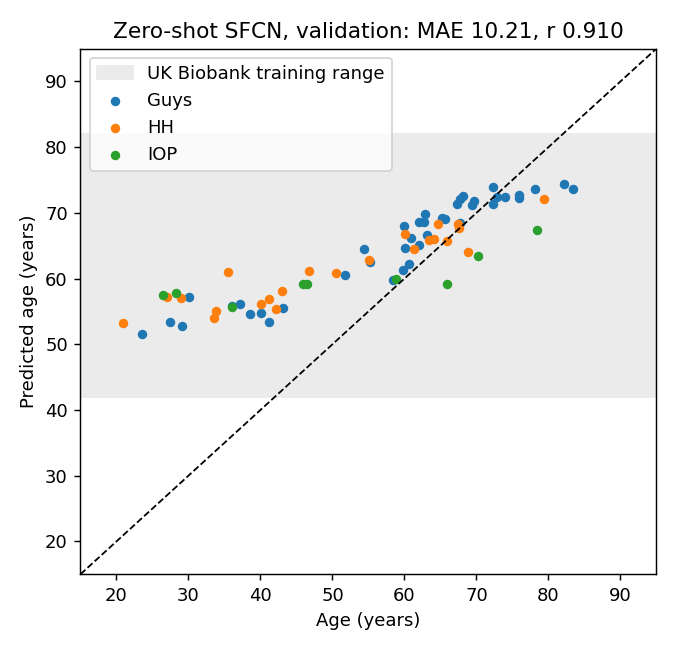
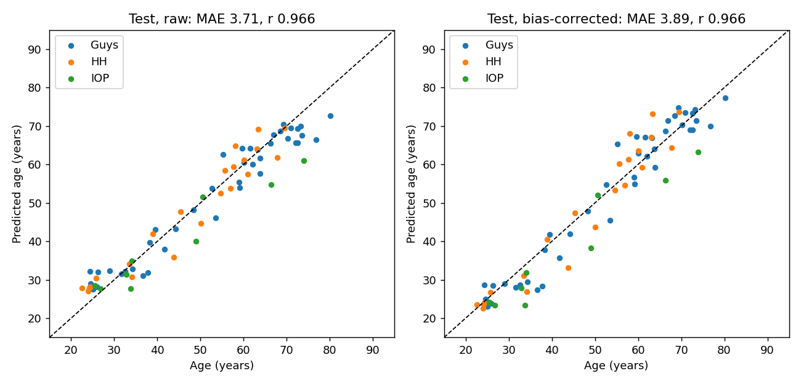

*Figure 1. Left: zero-shot SFCN on validation (grey band, the range of ages the pretrained head can output). Right: fine-tuned SFCN on the test set, raw and bias-corrected, coloured by site.*

**Comparison models.** The independently fine-tuned SFCN and DeepBrainNet reached validation MAE of 3.88 and 4.12, and test MAE of 4.07 and 4.53. The two SFCN fine-tunes are equivalent on validation. Because all pipelines were evaluated on the same test split, test numbers are not used to rank pipelines.

### 4.2 Fairness: sex and acquisition site

Test set, age-adjusted, 95% bootstrap CIs:

| Comparison | Corrected BAG (years) | Absolute error (years) |
|---|---|---|
| Male vs female | −0.59 [−2.67, +1.64] | −0.64 [−1.90, +0.59] |
| HH vs Guys | +1.06 [−1.44, +3.53] | +0.19 [−1.07, +1.47] |
| IOP vs Guys | **−5.06 [−8.66, −1.34]**, p = 0.012 | +1.92 [−1.36, +5.14] |

**Sex.** There is no detectable difference by sex.

**IOP.** IOP scans receive a corrected BAG about 5 years lower than Guys scans:

- 8 of the 9 IOP test subjects have a negative gap.
- Leaving out each IOP subject in turn gives an offset between −4.18 and −5.93.
- No group difference in absolute error has a CI that excludes 0.

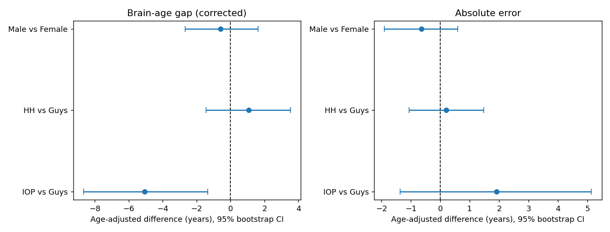

*Figure 2. Age-adjusted group differences in corrected BAG (left) and absolute error (right), test set.*

**Replication.** The IOP offset is absent in the training subjects, which the model fits closely (train MAE 1.5–2.4 years): −0.97 [−3.09, +1.15]. It appears independently in the validation set (−4.08 [−7.31, −0.85]) and the test set (−5.06). It is therefore a failure to generalise to new IOP individuals, not a chance finding in one split.

**Leave-one-site-out.**

| Held-out site | MAE change (years) | BAG change (years) |
|---|---|---|
| IOP unseen | **+3.30 [+1.62, +4.93]** (MAE 6.80 vs 3.59) | −2.14 [−4.42, +0.20] |
| HH unseen | +0.25 [−0.88, +1.36] | +0.51 [−1.34, +2.30] |
| Guys unseen | −0.71 [−1.86, +0.37] | +3.08 [+0.95, +5.08] (vs an HH + IOP reference) |

IOP is the one site a model cannot generalise to without having seen it, while HH generalises. The IOP-vs-Guys BAG difference has the same sign in every analysis.

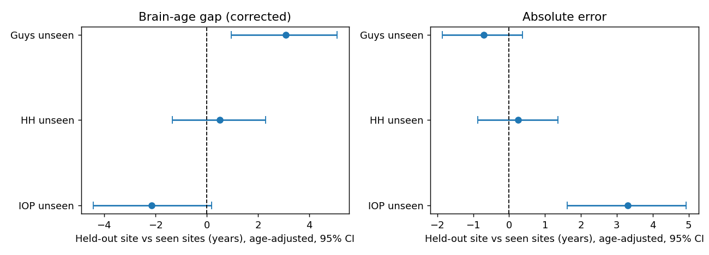

*Figure 3. Leave-one-site-out: each held-out site against the seen sites, age-adjusted.*

### 4.3 Attribution patterns

**Where the attribution falls.** Attribution concentrates on the deep grey matter around the lateral ventricles (thalamus, caudate, putamen), the periventricular white matter and the cerebellum. These structures are known to change with age.

**Sanity check.** Re-initialising the top layers changes the maps almost completely (median Spearman r = 0.13 between trained and randomised maps). The maps therefore depend on what the model learned.

**Deletion test.** On 60 held-out subjects, the maps rank regions by importance correctly at every fraction removed:

| Share of brain smoothed away | Highest-ranked | Random | Lowest-ranked |
|---|---|---|---|
| 5% | **4.83** [4.03, 5.69] | 1.04 [0.91, 1.18] | 0.46 [0.37, 0.56] |
| 10% | 6.05 | 1.89 | 0.70 |
| 20% | 8.71 | 4.17 | 1.21 |

*Values are |change in predicted age| in years.*

At 5%, removing the highest-ranked cells beats random removal by +3.79 years [3.03, 4.66], in 93% of subjects (Wilcoxon p = 5 × 10⁻¹¹). The highest-ranked regions matter most and the lowest-ranked matter least.

**Group differences.** After FDR correction:

- **no region differs by sex**;
- **attribution patterns differ between acquisition sites.** Compared with Guys, HH and IOP scans place less attribution on deep grey matter (−1.14 and −1.29 percentage points) and on the hippocampus and amygdala (−0.25, −0.28), and more on the cerebellum and unlabelled tissue (+2.66 HH; +1.98 IOP, q = 0.07). IOP also places less attribution on the brainstem (−0.90).

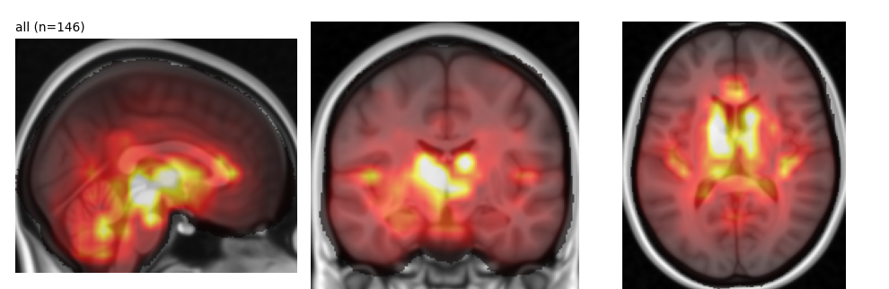
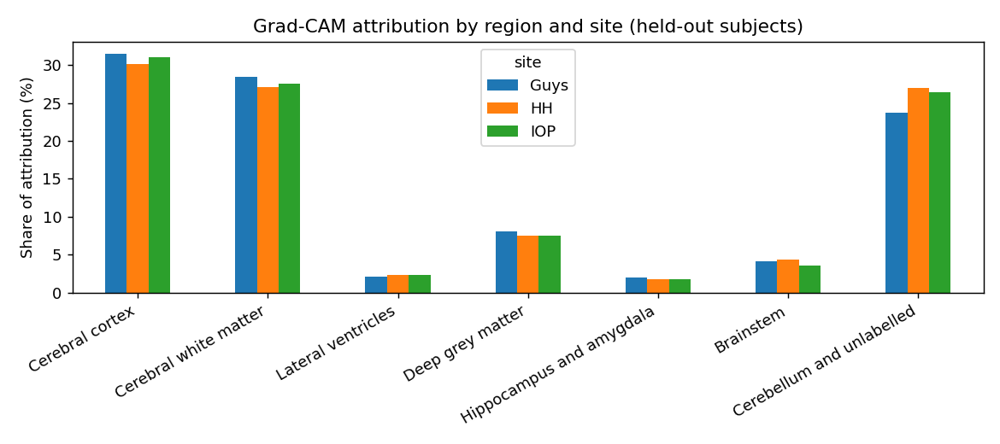

*Figure 4. Mean attribution map over held-out subjects (top) and share of attribution per coarse region, by site (bottom).*

### 4.4 Is the model right for the wrong reasons?

**The representation encodes the acquisition site.** A linear probe on the 64-d features identified the site of held-out scans with high accuracy:

| Features used by the probe | Balanced accuracy (chance 33%) |
|---|---|
| Age and sex only | 40.8% [31.2, 50.9] |
| Brain-intensity quantiles of the input image | 99.6% [98.7, 100] |
| Pretrained SFCN (never trained on IXI) | 92.8% [87.2, 96.9] |
| Fine-tuned SFCN | 93.5% [88.1, 97.7] |
| Fine-tuned SFCN, age and sex removed | **91.2% [86.6, 95.2]** |

All 18 held-out IOP scans were identified, and no other scan was labelled IOP. Who each site recruited explains almost none of this. The signature is already present before fine-tuning, so it reflects image appearance that survives our preprocessing rather than something learned from IXI. This shows that site information is *present* in the representation from which age is read out. It does not by itself show that the prediction *uses* it.

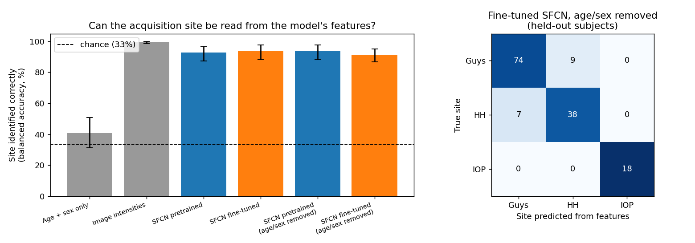

*Figure 5. Site probe: balanced accuracy by feature set (left); confusion matrix for fine-tuned features with age and sex removed (right).*

**Predicted age responds to acquisition appearance.** Changing only the intensity appearance of the same brains shifted predicted age substantially. These results use the age- and sex-standardised references and are relative to the own-site match:

- HH brains given an IOP appearance: **−3.92 years [−4.47, −3.38]**; 45 of 45 went younger.
- IOP brains given an HH appearance: **+3.14 [+2.44, +3.97]**; 18 of 18 went older.
- Guys brains given an HH appearance: +3.31.

Among single properties, strong blur (σ = 1.5 voxels) lowered predicted age by 3.17 years [1.24, 5.11]. Contrast changes moved it by about 0.4–0.9 years, noise and non-uniformity by less. The same anatomy therefore receives a different age depending on acquisition appearance.

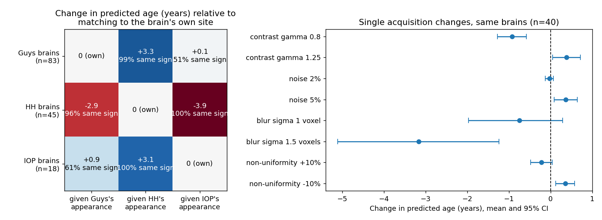

*Figure 6. Left: change in predicted age when each site's brains are given each site's intensity appearance. Right: single acquisition perturbations.*

**What the IOP offset is not.** We tested three acquisition-related explanations at IOP's measured levels:

1. **Global intensity distribution.** After standardising for recruitment age, swapping between the Guys and IOP appearances moved predicted age by at most about 1 year (Guys → IOP +0.11 [−0.18, +0.39]; IOP → Guys +0.90 [+0.17, +1.70]). Without the standardisation this effect looked larger (−0.60 / +1.60), because IOP's younger recruitment had leaked into its reference.
2. **Image smoothness.**
   - Native resolution is identical across sites (0.94 × 0.94 × 1.2 mm).
   - IOP inputs are nonetheless markedly smoother: gradient sharpness −2.09 SD, Laplacian sharpness −2.21 SD, smoothness FWHM +0.87 mm (+2.38 SD) versus Guys, age- and sex-adjusted.
   - Blurring Guys and HH brains to IOP's measured smoothness, however, did **not** lower predicted age: Guys +0.93 [+0.60, +1.28], HH +0.01 [−0.32, +0.36].
   - Gaussian blur also did not reproduce IOP's other sharpness measures, so IOP's softer appearance is not simple Gaussian smoothing.
3. **The site signature in the features.** ComBat harmonisation removed the signature: the site probe fell from 91.2% to 36.3%, close to chance. Accuracy was essentially unchanged (held-out MAE 3.81 → 3.90). The IOP offset, however, largely persisted: **−4.53 [−7.04, −2.01] → −3.95 [−6.40, −1.37]**.

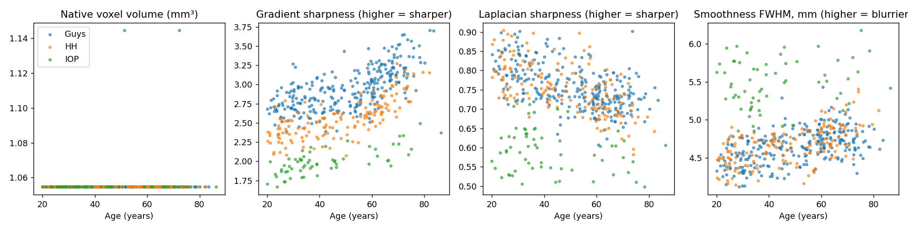
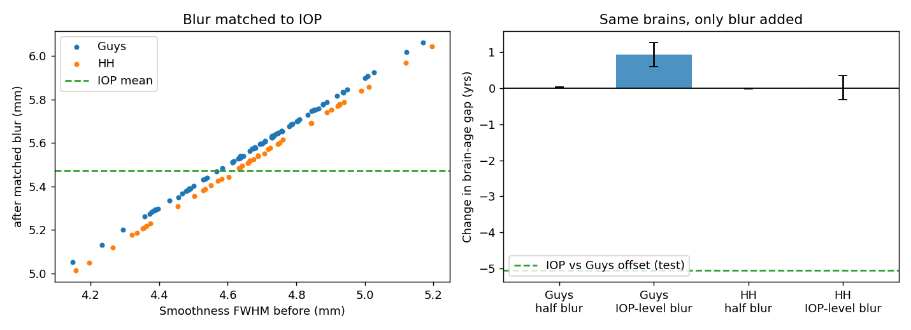
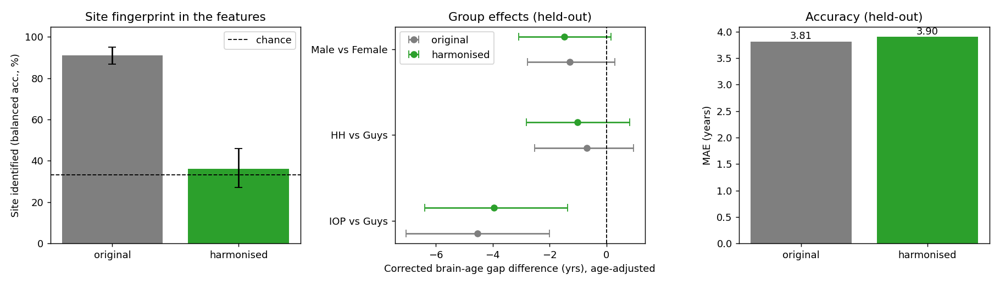

*Figure 7. Native voxel volume and three sharpness measures by site and age (top). Matched blur to IOP's smoothness (middle). ComBat harmonisation: site fingerprint, group effects and accuracy (bottom).*

### 4.5 Does the model know when it is unsure?

**Main model.** The spread of the model's predicted age distribution was larger for IOP (8.06 years, against 5.66 Guys and 6.39 HH). Age- and sex-adjusted, IOP's uncertainty was +2.48 years [+1.30, +3.65] above Guys. Overall, the model's 90% ranges contained the true age 88% of the time.

**Model never trained on IOP.** Its uncertainty on IOP doubled: 12.46 versus 6.13 for seen sites, +5.32 years [+4.65, +5.99]. Its 90% ranges still covered the true age 92% of the time despite an MAE of 6.80. It is less accurate there but signals it, rather than being confidently wrong. For HH, which the corresponding LOSO model generalises to, uncertainty barely rose (+0.79 [−0.08, +1.67]).

Per subject, however, uncertainty tracked error only weakly (Spearman +0.16). This is a group-level warning signal, not a per-scan error detector.

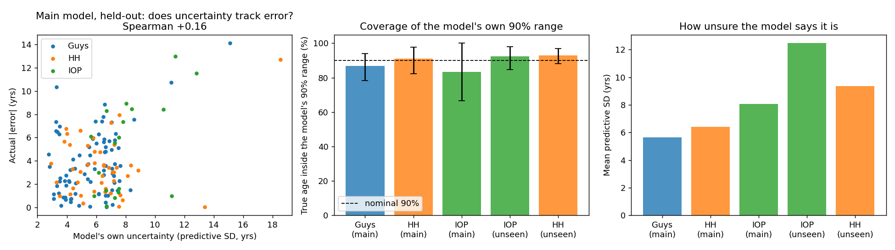

*Figure 8. Uncertainty against actual error (left); coverage of the model's own 90% range (middle); mean predictive uncertainty by site and LOSO condition (right).*

## 5. Discussion

**Accurate and fair across sex.** Fine-tuned SFCN predicts age on IXI with an error under 4 years, in line with published results on this dataset. We found no sex difference in brain-age gap, error or attribution, with intervals narrow enough to rule out differences larger than about 2–3 years.

**A robust acquisition-site effect at IOP.** IOP stands out in every analysis:

- its brain-age gap is about 5 years lower, replicated in validation and test;
- it is the only site a model cannot generalise to unseen;
- it is the most distinct site in the representation;
- the model is most uncertain about it.

These are acquisition-site effects in the descriptive sense. In IXI, site is confounded with the population each site recruited, so this design cannot attribute them to the scanner rather than the cohort.

**Partly right for the wrong reasons.** Two findings show that the model's behaviour depends on acquisition and not only on anatomy:

1. Its internal representation identifies the acquisition site at 91% accuracy, even after removing age and sex and before fine-tuning.
2. Its predicted age moves by 3–4 years when only a scan's intensity appearance changes.

The model is therefore not invariant to acquisition, and an unchanged brain could receive a different brain age on a different scanner. This matters for any use of the brain-age gap across sites.

**But the IOP offset is not a simple scanner artefact.** The most obvious acquisition explanations fail at IOP's measured levels:

- the global intensity profile accounts for about 1 year;
- matched smoothness accounts for none;
- removing the representation's site signature leaves most of the offset.

Combined with the observation that the offset appears only for new IOP individuals, this points either to acquisition properties not modelled here, such as the spatial pattern of tissue contrast or vendor-specific reconstruction and geometry, or to genuine differences in IOP's cohort. IXI cannot separate these. Resolving the question would need travelling-subject data (the same people scanned at several sites) or a larger multi-site sample.

**The model flags the problem itself.** Its predictive uncertainty rises at IOP, and doubles when IOP is unseen, while its ranges keep near-nominal coverage. In practice, elevated group-level uncertainty on a new site could serve as a warning that brain-age gaps there should not be compared directly with other sites.

**Attribution.** The maps are plausible: they concentrate on periventricular deep grey matter and white matter. They also pass both validity checks, as they depend on the learned weights and removing their top-ranked regions changes predictions most. Their site differences are consistent with the representation-level site signature. Following our wording rule, we report that attribution patterns *differ between* sites; we do not claim the model reasons differently.

## 6. Limitations

- **Small subgroups.** There were 9 IOP test subjects and 18 held-out. Intervals for IOP are wide, although the offset replicated across splits.
- **Single seed and single split.** The CIs reflect which subjects were sampled, not training randomness.
- **Site confounded with cohort.** In IXI, site differences cannot be separated from recruitment differences.
- **Perturbations are approximations.** Quantile matching changes the global intensity distribution only, and Gaussian blur did not reproduce IOP's full sharpness profile. Other acquisition differences remain untested.
- **Harmonisation in feature space only.** ComBat was applied to the pooled features, and the age head was not retrained. Image-level harmonisation or site-adversarial training could behave differently.
- **Attribution method.** Gradient × activation at an intermediate layer has 8 mm resolution. Deletion tests are themselves affected by distribution shift from the occlusion.
- **Uncertainty is uncalibrated.** It is the softmax spread of a model trained with soft labels, not a calibrated predictive interval.
- **No clinical claims.** These are healthy volunteers, and no clinical conclusion follows from this work.

## 7. Conclusion

A fine-tuned SFCN brain-age model is accurate on IXI and shows no sex disparity, but it is not acquisition-invariant:

- it carries a strong site signature in its representation;
- its predictions shift with acquisition appearance alone;
- one site shows a robust brain-age offset and poor generalisation when unseen.

That offset is not explained by intensity, smoothness or the representation's site signature, and its cause, deeper acquisition differences or cohort differences, cannot be determined from IXI. The model's own uncertainty rises where it is least reliable. Auditing beyond accuracy changed the answer to "is this model good?": it is accurate, but brain-age gaps from it should not be compared across acquisition sites without site-aware validation.

## 8. Reproducibility and contributions

**Code.** All code is in [`scripts/`](../scripts/), numbered by phase:

| Step | Script |
|---|---|
| Labels | `01b` |
| Preprocessing | `02b` |
| Zero-shot | `03b` |
| Fine-tuning | `04` |
| Test evaluation | `05` |
| Fairness audit | `06` |
| Leave-one-site-out | `06b` |
| Attribution | `07` |
| Site probe | `08` |
| Stress test | `09` |
| Image sharpness | `10` |
| Blur to IOP | `11` |
| Harmonisation | `12` |
| Uncertainty | `13` |
| Deletion test | `14` |

Each script documents its inputs, outputs and any choices. [`PROJECT_GUIDE.md`](../PROJECT_GUIDE.md) records every result with its date. The comparison models are in [`experiments/`](../experiments/).

**Hardware.** Fine-tuning ran on a Colab T4 GPU. Every analysis after fine-tuning ran on a laptop CPU.

**Contributions:** *(to be completed by the team).*

## References

- Adebayo J. et al. (2018). Sanity checks for saliency maps. *NeurIPS*.
- Bashyam V. M. et al. (2020). MRI signatures of brain age and disease over the lifespan based on a deep brain network and 14,468 individuals worldwide. *Brain* 143(7):2312–2324.
- Cole J. H. et al. (2018). Brain age predicts mortality. *Molecular Psychiatry* 23:1385–1392.
- Draelos R. L. & Carin L. (2020). Use HiResCAM instead of Grad-CAM for faithful explanations of convolutional neural networks. arXiv:2011.08891.
- Forman S. D. et al. (1995). Improved assessment of significant activation in functional magnetic resonance imaging (fMRI): use of a cluster-size threshold. *Magnetic Resonance in Medicine* 33(5):636–647.
- Fortin J.-P. et al. (2018). Harmonization of cortical thickness measurements across scanners and sites. *NeuroImage* 167:104–120.
- Johnson W. E., Li C. & Rabinovic A. (2007). Adjusting batch effects in microarray expression data using empirical Bayes methods. *Biostatistics* 8(1):118–127.
- Peng H. et al. (2021). Accurate brain age prediction with lightweight deep neural networks. *Medical Image Analysis* 68:101871.
- Samek W. et al. (2017). Evaluating the visualization of what a deep neural network has learned. *IEEE Transactions on Neural Networks and Learning Systems* 28(11):2660–2673.
- Selvaraju R. R. et al. (2017). Grad-CAM: visual explanations from deep networks via gradient-based localization. *ICCV*.
- IXI dataset: https://brain-development.org/ixi-dataset/ (CC BY-SA 3.0).
